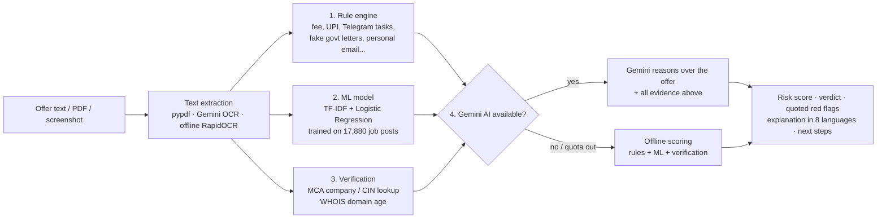
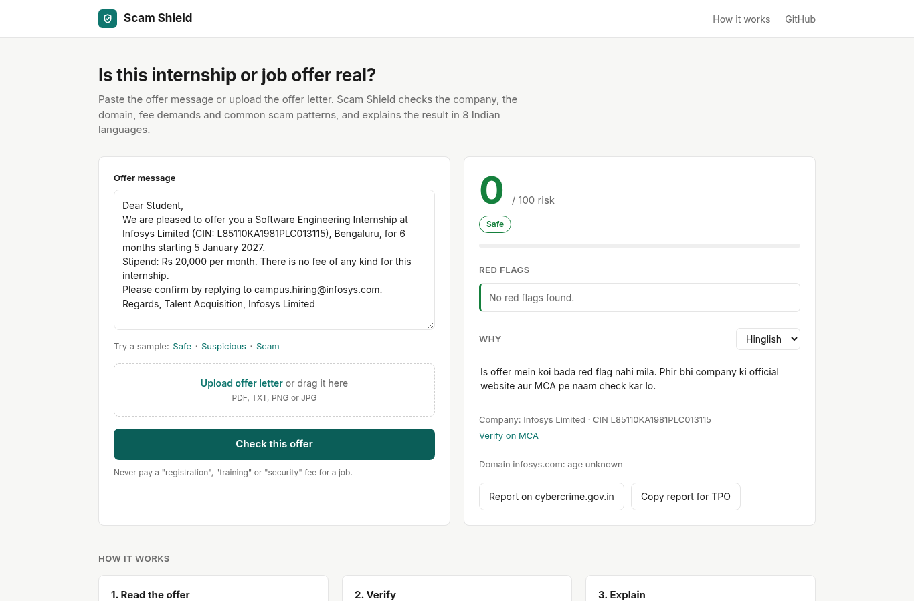
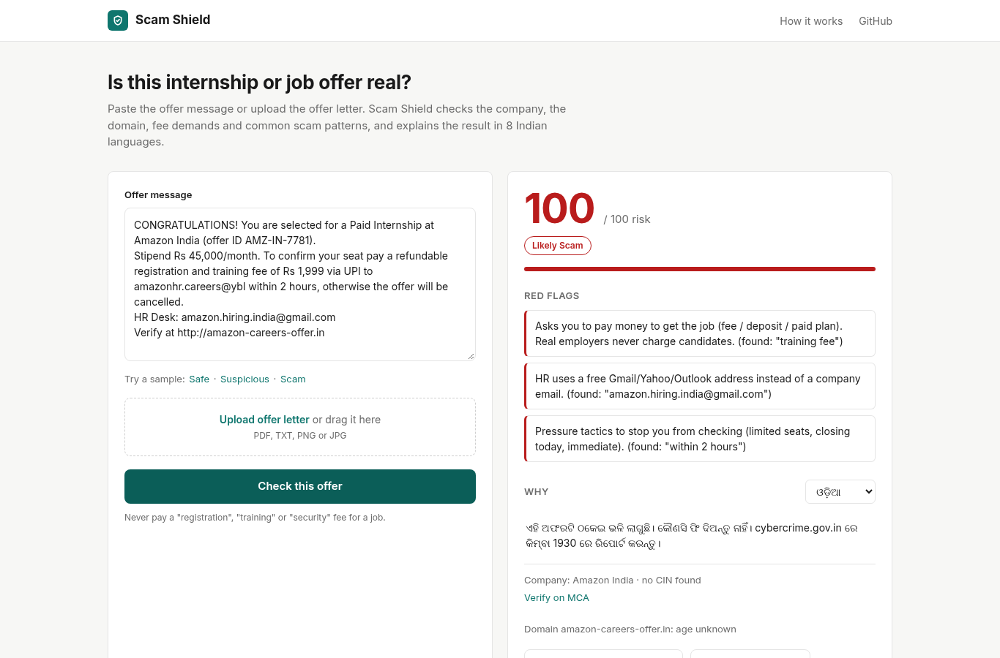

<div align="center">

# 🛡️ Scam Shield

### Check any internship or job offer in 10 seconds, before you pay a single rupee.

**An offline-capable scam detector for Indian students: rules + a trained ML model + live company verification + Gemini AI, explained in 8 Indian languages.**

     

*[🔗 Live demo](https://scam-shield-cxtg.onrender.com)*


</div>

---

## ⚡ In one minute

- **The problem:** fake internship and job offers ("pay ₹999 registration", "refundable laptop deposit", "earn per Google review on Telegram") target students who have never seen a real offer letter.
- **What Scam Shield does:** paste the message or upload the PDF / screenshot. In seconds you get a **0-100 risk score**, the **exact red-flag lines quoted back**, a **company check (MCA + domain age)**, and a plain explanation in **English, Hinglish, हिन्दी, ଓଡ଼ିଆ, বাংলা, தமிழ், తెలుగు, मराठी**.
- **Why it's different:** it keeps working with **no AI and no internet API**. A trained ML model and a rule engine run on-device; Gemini adds deeper reasoning when available.
- **Trained and tested on real data:** the ML model is trained on **17,880 real job postings** (866 confirmed fakes). On 3,576 of them held out from training, rules + ML flagged **83% of fakes** (vs 10% for rules alone) while marking only **0.3% of genuine posts as Likely Scam**. On **22,000 real Indian Naukri posts**, 97% came back Safe.

---

## 🚨 The problem: how big, how bad

| | Number | Source |
|---|---|---|
| Money lost to cyber fraud in India (5 years) | **₹55,659 crore** across **65.9 lakh** complaints | MHA data, Times of India, 11 Feb 2026 |
| Cyber fraud complaints in just 6 months | **12.7 lakh** | Indian Express, 14 Jul 2026 |
| One fake-job racket alone | **33 lakh job seekers**, ₹33 crore | Gujarat cyber police, New Indian Express, 24 Aug 2026 |
| Google-review "task" scam | 20+ people lost **₹1 crore in a month** | Livemint, 19 Oct 2026 |
| A single student victim | BCA student lost **₹10 lakh** to a task fraud | Times of India, 26 Oct 2026 |
| Who is most exposed | Graduates are **2 in 3** of India's jobless youth | India Today, Jul 2026 |

Even top institutes are warning students: IIT Roorkee issued an advisory against fake internship offers (Telegraph India, 21 Mar 2026).

**The human cost goes beyond money:** victims hand over Aadhaar, PAN and bank details, lose months waiting for a job that doesn't exist, and many never report it out of embarrassment.

**The gap:** existing scam checkers focus on calls, SMS links or shopping sites. Nobody reads an *offer letter* the way a placement officer would, in the student's own language, for free.

---

## 🧠 How it works: four layers, each one a safety net



| Layer | What it catches | Needs internet / API? |
|---|---|---|
| **Rule engine** | Indian scam patterns: registration / training / "refundable" fees, UPI "approve request" calls, Telegram/WhatsApp-only recruiting, paid like/review tasks, fake government appointment letters, personal Gmail HR, urgency, referral chains, missing company details | No |
| **ML model** | Polished fake posts that *look* normal, learned from 866 confirmed fake postings | No |
| **Verification** | Company name / CIN with a direct MCA lookup; flags website domains registered < 6 months ago | Internet (no API key) |
| **Gemini AI** | New scam wording the rules have never seen; writes case-specific explanations | Gemini API key |

**Designed to never go down:** if Gemini is unavailable or out of quota, Scam Shield switches to offline mode automatically, pauses AI calls until the quota resets, and still returns a full answer. A per-visitor daily cap protects the shared AI quota on the public demo.

---

## 📊 Results

### Training data
The ML model is trained on the **EMSCAD dataset: 17,880 real job postings, 866 confirmed fraudulent**. For evaluation we used a standard 80/20 split: trained on 14,304 posts, tested on the remaining 3,576 it had never seen. The shipped model is then retrained on all 17,880.

### On unseen job postings
EMSCAD 20% held-out test set (173 fake, 3,403 genuine). Offline mode, no Gemini.

| | Rules only | **Rules + ML** |
|---|---|---|
| Fake posts flagged (Suspicious or Likely Scam) | 10% | **83%** |
| Fake posts marked Likely Scam | 0.6% | **73%** |
| Genuine posts wrongly marked Likely Scam | 0.2% | **0.3%** |
| Genuine posts wrongly marked Suspicious | 6.4% | 6.7% |

ML model alone: **ROC-AUC 0.99**; at a 0.7 threshold it catches 82% of fakes with 97% precision.

### On real Indian scam messages
16 samples from public reports (r/InternshipsIndia, r/techfreshers, r/pune, police advisories, a PIB fact-check) and genuine careers pages (Groww, Rubrik, Razorpay, Paytm):

| Type | Result |
|---|---|
| 9 scams (fee, deposit, task, fake govt letter, UPI call) | **9/9 Likely Scam** |
| WhatsApp "back office" job asking for Aadhaar/PAN | **Likely Scam** |
| 4 genuine offers | **4/4 Safe** |
| 2 tricky cases (₹199 "kit fee", walk-in SMS with no company) | Likely Scam / Safe (low score, 20) |
| Screenshots (PNG) of task scams, read with offline OCR | **Likely Scam (100)** |

### On 22,000 real Indian job posts (Naukri.com)
[Jobs on Naukri.com](https://huggingface.co/datasets/jason1966/PromptCloudHQ_jobs-on-naukricom) (22,000 real listings scraped from Naukri, 2016, unlabelled). These are real posts, not AI-generated.

| Verdict | Posts |
|---|---|
| Safe | 21,348 (97.0%) |
| Suspicious | 454 (2.1%) |
| Likely Scam | 198 (0.9%) |

We manually checked 25 random "Likely Scam" posts: about 10 looked like real scams (pay-to-join "medical coding" training, "earn ₹3k–8k/week from home" typing work), and about 15 were false alarms (ordinary receptionist and admin ads). So on real Indian listings Scam Shield stays quiet on ~97% of posts and its false "Likely Scam" rate is roughly 0.5%.

### On 2,000 real crowdsourced Indian SMS (Hindi + English)
[Indian SMS spam dataset](https://github.com/princebari/-SMS-Spam-Classification-on-Indian-Dataset-A-Crowdsourced-Collection-of-Hindi-and-English-Messages), real messages crowdsourced in India by Yadav, Kumaraguru et al. (2011).

- **1,000 genuine personal messages:** 867 Safe (86.7%), 124 Suspicious, only 9 Likely Scam (0.9%). All 12 genuine job-related messages were Safe.
- The "spam" half is mostly promotional ads, not scams, so we did not use it as a scam-catch score. Among its job messages, classic money-for-nothing offers were flagged, e.g. *"WORK FROM HOME US BASED MNC EARN EXTRA INCOME UP TO 30K TO 1LAK"* → Likely Scam, *"WORK on MOBILE. Earn 5000+ Per day"* → Suspicious.

*Honest notes:* EMSCAD is mostly US/English job ads, so the ML layer is strongest on polished fake postings while the rule engine covers Indian WhatsApp/Telegram fee and task scams. The rule engine was tuned on the 16 Indian samples above, so those results show it works on real messages, not that it catches every scam.

---

## ✨ Features

- 📋 **Paste or upload:** WhatsApp / email text, `.txt`, PDF offer letters, PNG/JPG screenshots
- 🎯 **0-100 risk score** with a clear verdict: Safe / Suspicious / Likely Scam
- 🔍 **Quoted evidence:** every red flag shows the exact words it found
- 🏢 **Company check:** extracts company name and CIN, one-tap MCA verification link
- 🌐 **Domain age check:** flags websites registered in the last 6 months
- 🗣️ **8 Indian languages** for the explanation
- 🚓 **Next steps:** report at cybercrime.gov.in / helpline 1930
- 📣 **"Copy report for TPO":** one tap to warn your placement cell or class group
- 📴 **Works offline from AI:** rules + ML + offline OCR, no API key required
- 🔒 **Private:** offers are analysed in memory and not saved to any database

<div align="center">
 
<br><sub>Left: a genuine offer with CIN marked Safe. Right: the same scam explained in Odia.</sub>
</div>

---

## 🛠️ Tech stack

| Part | Tech |
|---|---|
| Backend | Python 3.12, FastAPI |
| AI | Google Gemini via `google-genai` |
| ML | scikit-learn (TF-IDF + Logistic Regression), joblib |
| OCR | Gemini vision, RapidOCR (offline, ONNX) |
| Verification | `python-whois`, MCA company master data link |
| Files | `pypdf` |
| Frontend | Single `index.html` (vanilla JS + CSS) served by FastAPI |
| Tests | pytest + FastAPI TestClient |
| Built in | **AgentFoundry**, official IDE of Code for a Billion |

```
backend/
  main.py               API, rule engine, ML layer, OCR, Gemini, quota protection
  requirements.txt
  model/
    scam_model.joblib   TF-IDF + Logistic Regression trained on EMSCAD (17,880 posts)
  tools/
    whois_check.py      domain age (WHOIS), company / CIN extraction, MCA link
frontend/
  index.html            UI
docs/                   screenshots
tests/
  test_main.py
```

---

## 🚀 Run it yourself

```bash
git clone https://github.com/HaraPrasadGouda/scam-shield.git
cd scam-shield
python -m venv .venv
.venv\Scripts\activate          # macOS/Linux: source .venv/bin/activate
pip install -r backend/requirements.txt
python -m uvicorn backend.main:app --port 8000
```

Open http://127.0.0.1:8000. That's it: it works in offline mode with no key.

**Optional, for Gemini AI:** create `backend/.env`:

```
GEMINI_API_KEY=your_key_here
GEMINI_MODEL=gemini-3.8-flash
```

Run tests: `pytest -q`

### Deploy (Render, free tier)
- Build: `pip install -r backend/requirements.txt`
- Start: `uvicorn backend.main:app --host 0.0.0.0 --port $PORT`
- Env: `GEMINI_API_KEY`, `GEMINI_MODEL=gemini-3.8-flash`, `PYTHON_VERSION=3.12.3`
- Optional: `GEMINI_PER_IP_DAILY` (default 3 AI checks per visitor per day, then offline mode; `0` = no cap)

### API

`POST /check-offer` (multipart form): `offer_text` and/or `file`

Returns `risk_score`, `verdict`, `red_flags`, `reasons` (8 languages), `mca_info`, `domain_reports`.

`GET /health`: status, whether Gemini is configured, model name.

---

## 🧭 Limitations and roadmap

**Today**
- A risk score is guidance, not proof: always confirm on MCA and the company's official careers page.
- The ML training data is mostly US job ads; the Indian side relies on the rule engine and Gemini.
- Some registrars hide domain creation dates.
- Real, labelled Indian job-scam data is not publicly available, so Indian scam-catching is shown on 16 real samples; false alarms are measured on 22,000 real Naukri posts and 1,000 real Indian SMS. We deliberately did not use AI-generated datasets.
- Some genuine offers can be marked Suspicious; Suspicious means "verify first", not "scam".
- A missing company name only raises the score strongly when another warning sign is present, so a bare scam SMS with no money ask or contact trick can slip through as Safe.

**Next**
- 📱 WhatsApp bot: forward a suspicious offer, get the verdict back in chat
- 🇮🇳 Indian training data: build a labelled dataset of Indian scam offers with college placement cells
- 🏫 TPO dashboard: placement cells see which scams are hitting their students
- 🔗 One-tap cybercrime.gov.in complaint pre-filled from the analysis

---

## 🤖 Built with AgentFoundry

Created and developed in **AgentFoundry (AF)**: the base app was generated by AF's SMART-CODE agent, and later upgrades (google-genai SDK, new UI, tools) were built with Gemini CLI inside the AF IDE, where the code was also run, tested and pushed. An AI assistant helped with code review and collecting test samples.

---

## 📚 Sources

- Times of India, 11 Feb 2026: "Rs 55,659 crore lost in 65.9 lakh cyber fraud complaints in 5 years: MHA"
- Indian Express, 14 Jul 2026: "Cyber fraud complaints cross 12.7 lakh in 6 months"
- New Indian Express, 24 Aug 2026: "₹33 crore fraud, 33 lakh job seekers: Gujarat cyber cops bust pan-India scam"
- Livemint, 19 Oct 2026: "Google Review scam: over 20 people reportedly lose ₹1 crore in a month"
- Times of India, 26 Oct 2026: "Ahmedabad: BCA student loses Rs 10L in task fraud"
- India Today, Jul 2026: graduates are 2 in 3 of India's jobless youth
- Telegraph India, 21 Mar 2026: IIT Roorkee advisory on fake internship offers
- EMSCAD (Employment Scam Aegean Dataset): 17,880 job postings, 866 fraudulent

---

## 📄 License

MIT, see [LICENSE](LICENSE).

<div align="center">

**Built by [Hara Prasad Gouda](https://github.com/HaraPrasadGouda) for Code for a Billion 2026**

*If this stops even one student from paying a fake "registration fee", it was worth building.*

</div>
